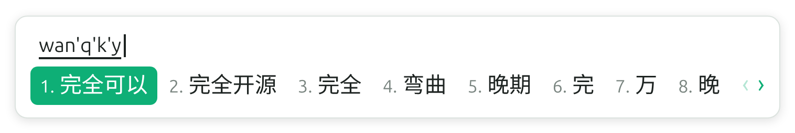
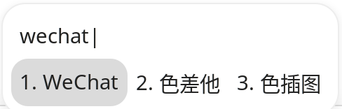
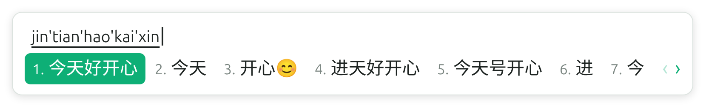
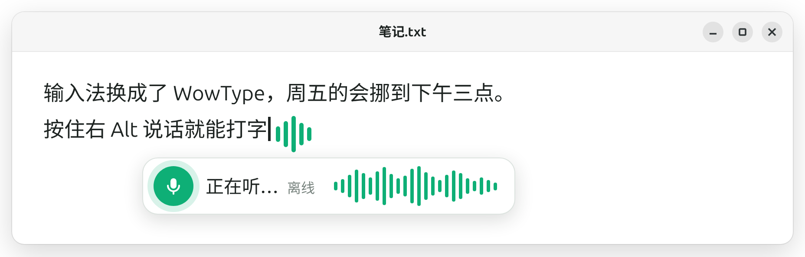
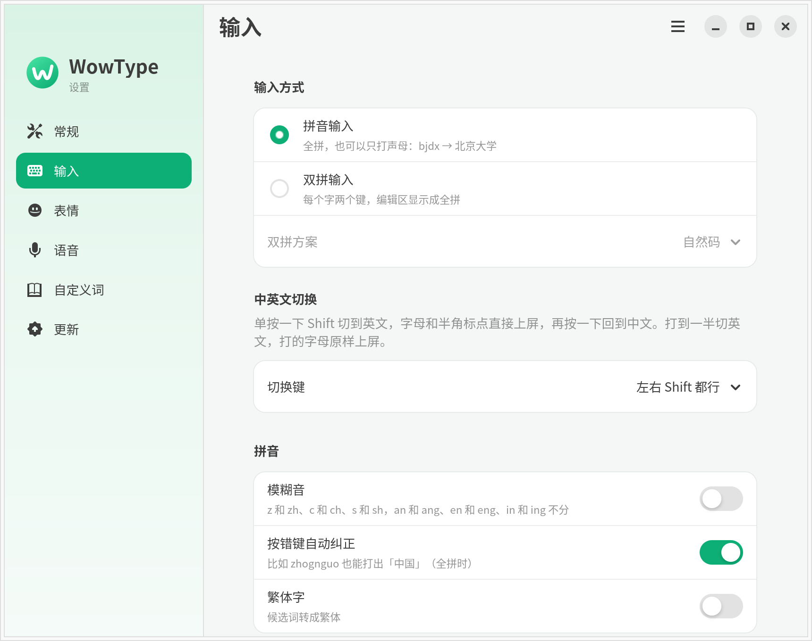
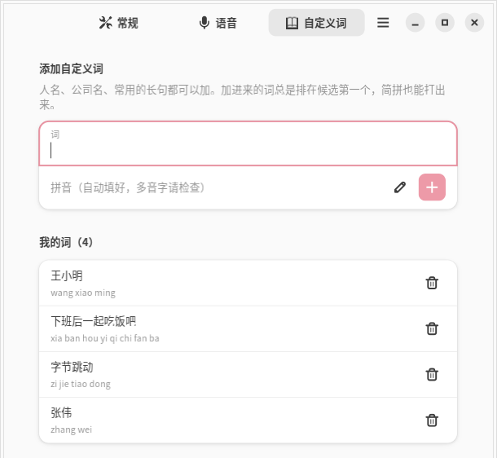
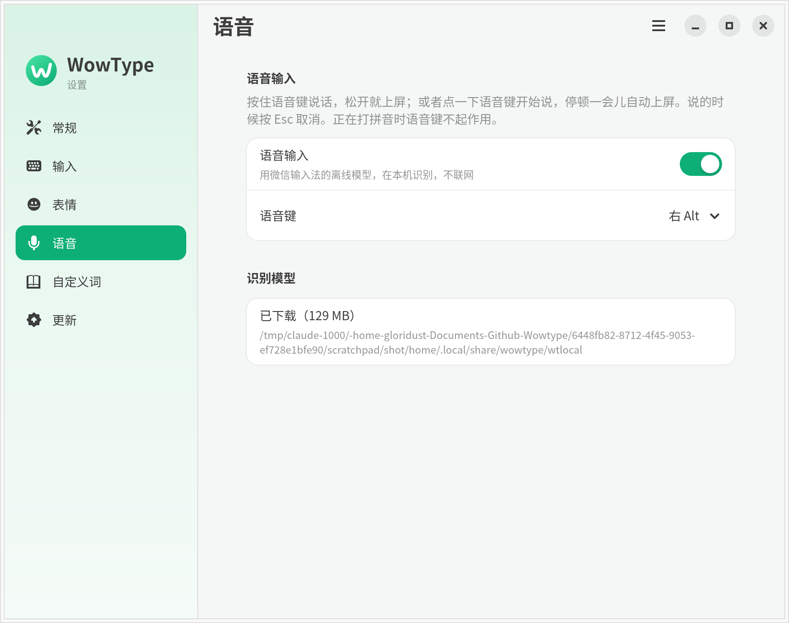
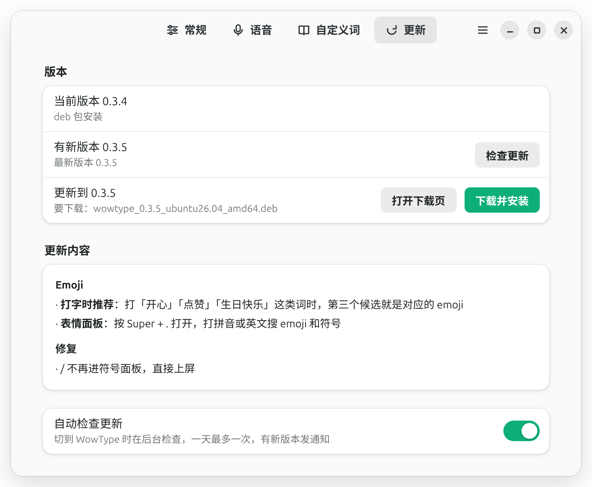
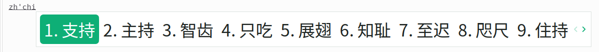
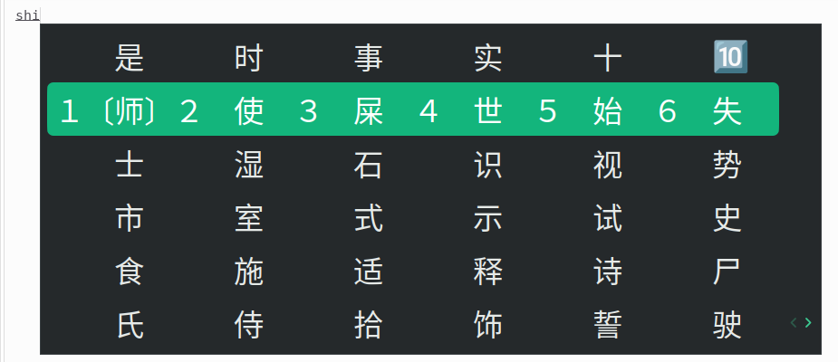

<div align="center">


# WowType

**在 Linux 上打字，像微信输入法一样顺手。**

一个 fcitx5 拼音输入法：长句一次打完、打一半就有词、按错键也能认出来，越用越懂你。

[](https://github.com/Gloridust/WowType/actions/workflows/ci.yml)
[](https://github.com/Gloridust/WowType/releases)


[安装](#安装) · [使用](#使用) · [设置](#设置) · [常见问题](#常见问题) · [工作原理](#工作原理) · [参与开发](#参与开发)

https://github.com/user-attachments/assets/b9ee2854-3718-461b-a58c-0a0e72f78253

</div>

## 特性

<p align="center"><br>
<sub>候选横排，和微信输入法一样：整句只留几个，后面是词，最后是单字</sub></p>

- **整句输入**：`xiangquzijieshangban` 直接出「想去字节上班」；后面跟着句子的前半截，可以先上屏一段，剩下的拼音接着改。
- **半成品也有词**：`zhongg` 就有「中国」，不用打全。打全了的拼音正好是个词时，它一定排第一。
- **按错键能认出来**：按成相邻键、两个键按反、多按或漏按一个键（`zhognguo` → 中国）。本来就打对的输入不受影响。
- **越用越懂你**：记住你选过的词和常连着用的词（选过一次「我们再讨论」，下次就不会出「我们在讨论」），30 天不用会慢慢淡掉。
- **简拼、省略韵母、中英混打**：`bjdx` → 北京大学；有的音节只打声母也行，`kyi` → 可以、`yongzwen` → 用中文；zh/ch/sh 可以当一个声母，`zhch`、`zhchi` → 支持；`github` → GitHub。
- **候选横排**，和微信输入法一样：整句只留几个，后面是词，最后是单字。
- **语音输入**：按住右 `Alt` 说话，松开就上屏；也可以点一下右 `Alt` 说，说完停一下自动结束。用微信输入法的离线识别模型，在本机识别，不上传录音。
- **Emoji**：打「开心」「点赞」「生日快乐」时，第三个候选就是对应的 emoji；按 `Super` + `.` 打开表情面板，打拼音或英文搜 emoji 和符号（`xiao` → 😂、`pizza` → 🍕、`youjiantou` → →）。
- **繁体、模糊音、双拼**：可切繁体输出；可开模糊音；双拼支持自然码、小鹤、微软、搜狗、智能 ABC、紫光、拼音加加，双拼也有整句、句首词和分段选词，编辑区显示全拼。
- **图形设置界面**：候选排列、模糊音、语音键都在「WowType 设置」里点一下就改，马上生效；还能加自定义词（人名、公司名、常用的长句），加进去的词排第一，简拼也能打。
- **快、全在本地**：89 万词的词库，按一个键一般几毫秒内出候选；不联网，输入内容不离开你的电脑（语音模型第一次用时下载一次）。

<table>
<tr>
<td align="center" width="50%">
<br>
<b>长句一口气打完</b><br>
<sub>还能只上屏前半截「想去字节」，剩下的接着选</sub>
</td>
<td align="center" width="50%">
<br>
<b>按错顺序，没关系</b><br>
<sub><code>weixni</code> 照样是「微信」</sub>
</td>
</tr>
<tr>
<td align="center">
<br>
<b>全简拼混打，也没问题</b><br>
<sub><code>wanqky</code> → 完全可以</sub>
</td>
<td align="center">
<br>
<b>中英混打，不用切换</b><br>
<sub><code>wechat</code> → WeChat，大小写按词表来</sub>
</td>
</tr>
<tr>
<td align="center">
<br>
<b>打着字，顺手就有表情</b><br>
<sub>第三个候选是「开心😊」，选了上屏「今天好开心😊」</sub>
</td>
<td align="center">
<br>
<b>按住右 Alt 说话</b><br>
<sub>离线识别，录音不上传</sub>
</td>
</tr>
</table>

## 示例

更多例子（默认词库雾凇拼音实际打出来的候选，可以用 `wowtype-show` 自己试）：

| 输入 | 候选（前几个） | 说明 |
|---|---|---|
| `xiangquzijieshangban` | **想去字节上班** · 想去字节 · 想去字节商办 · 想去自解上班 · 想去 | 整句；第 2 个是句子前半截，选了只上屏这一段 |
| `hengxianghouxuanci` | **横向候选词** · 横向 · 横向后选词 · 横 · 哼 · 衡 | 整句只留几个，然后是词，再是单字 |
| `zhongg` | **中国** · 中共 · 忠告 · 中高 · 重工 | 没打完也有词 |
| `weixni` | **微信** · 威信 · 唯心 · 为新 | 两个键按反了（`xin` 打成 `xni`） |
| `zhognguo` | **中国** · 种过 · 重过 | 两个键按反了 |
| `bjdx` | **北京大学** · 北京电信 · 半径大小 | 简拼 |
| `sz` | **设置** · 甚至 · 随着 · 深圳 · 是指 | 简拼 |
| `wanqky` | **完全可以** · 晚期一 · 完企业 · 完其余 · 完全开源 | 全拼和简拼混着打 |
| `yongzwen` | **用中文** · 用正文 · 拥着我 · 用在 · 用作 | 全拼和只打声母的音节混着打 |
| `wechat` | **WeChat** · 色差他 · 色插图 | 英文词按词表里的写法给出 |
| `github` | **GitHub** | 同上 |

## 安装

### 系统要求

- Linux x86_64，输入法框架 **fcitx5 5.1 或更新**
- 有现成安装包的发行版：**Ubuntu 24.04 / 26.04、Debian 13**。其他发行版（Arch、Fedora……）请[从源码构建](#方式二从源码构建)
- Ubuntu 22.04 自带的 fcitx5 是 5.0，不支持

### 一行命令安装（推荐）

Ubuntu 24.04 / 26.04、Debian 13 上，在终端里运行：

```bash
curl -fsSL https://raw.githubusercontent.com/Gloridust/WowType/main/install.sh | bash
```

它会：

1. 下载和你系统对应的最新安装包（词库已经在包里，约 29 MB），按 `SHA256SUMS` 校验
2. 用 `sudo apt-get install` 装上，顺带装好 fcitx5 和设置界面要用的 GTK 4 / libadwaita
3. 输入法框架还不是 fcitx5（Ubuntu 默认是 IBus）时，问你要不要用 `im-config` 切过去
4. 把 WowType 加进 fcitx5 的输入法列表；fcitx5 正在运行的话会先重启它一次

装完按提示做：切换了输入法框架的话**注销并重新登录**，然后按 `Ctrl+Space` 切到 WowType，打 `nihao` 试试。
以后再跑一遍同样的命令就是升级（设置界面里也会提醒有新版本）。

> 想先看看脚本做了什么：[install.sh](install.sh)。
> 不想让它改输入法框架或重启 fcitx5，可以加环境变量，例如 `curl -fsSL … | WOWTYPE_NO_IM_CONFIG=1 WOWTYPE_NO_RESTART=1 bash`。
>
> GNOME（Ubuntu 默认桌面）在 Wayland 下，建议再装 GNOME Shell 扩展
> [Input Method Panel](https://extensions.gnome.org/extension/261/kimpanel/)，
> 活动概览的搜索框等地方才能显示候选框。

### 手动安装

#### 第 1 步：确认你在用 fcitx5

Ubuntu 默认用的是 IBus。先装好 fcitx5 并设为默认输入法框架（已经在用 fcitx5 的跳过这步）：

```bash
sudo apt install fcitx5 fcitx5-config-qt \
  fcitx5-frontend-gtk3 fcitx5-frontend-gtk4 fcitx5-frontend-qt5
im-config -n fcitx5
```

然后**注销并重新登录**。登录后右上角托盘里应该有一个键盘图标。

#### 第 2 步：安装 WowType

##### 方式一：安装包

到 [Releases](https://github.com/Gloridust/WowType/releases) 页面下载和你系统对应的那**一个**文件
`wowtype_<版本>_<发行版>_amd64.deb`（`ubuntu24.04`、`ubuntu26.04`、`debian13`），词库已经包含在里面。
不知道自己是哪个发行版：

```bash
. /etc/os-release && echo "$ID$VERSION_ID"     # 例如 ubuntu24.04
```

在下载目录里安装：

```bash
sudo apt install ./wowtype_*_amd64.deb
```

`apt` 会顺带装上设置界面要用的 GTK 4 和 libadwaita（`python3-gi`、`gir1.2-gtk-4.0`、`gir1.2-adw-1`）。
加了 `--no-install-recommends` 的话不会装，打字不受影响，只是打不开设置界面。

> 0.3.3 及以前的版本，词库是单独的 `wowtype-data-rime-ice` 包。装新版时 apt 会自动把它删掉（文件由新包接管），不用管它。

##### 方式二：从源码构建

适合其他发行版，或者想用最新代码的情况。下面以 Debian/Ubuntu 为例，其他发行版装对应的包即可
（需要：C++20 编译器、CMake ≥ 3.16、extra-cmake-modules、fcitx5 的开发包、ALSA 开发包（语音输入用）、Rust 1.70+、Python 3、git；
设置界面另外要 PyGObject、GTK 4 和 libadwaita 1.4+）。

```bash
# 1. 依赖
sudo apt install build-essential pkg-config cmake extra-cmake-modules \
  libfcitx5core-dev libfcitx5config-dev libfcitx5utils-dev libasound2-dev git python3 curl
sudo apt install python3-gi gir1.2-gtk-4.0 gir1.2-adw-1    # 设置界面用，不装也能打字
curl -sSf https://sh.rustup.rs | sh        # 已经装了 Rust 的跳过

# 2. 代码
git clone https://github.com/Gloridust/WowType.git
cd WowType

# 3. 编译并安装插件和设置界面（Rust 核心静态链接进插件，不用另装 .so）
cargo build --release -p wowtype-core
cmake -S fcitx5-addon -B build -DCMAKE_BUILD_TYPE=Release -DCMAKE_INSTALL_PREFIX=/usr
cmake --build build -j"$(nproc)"
sudo cmake --install build

# 4. 词库：从雾凇拼音生成，放到用户目录（约 30 秒，需要联网下载 rime-ice 和语言模型）
scripts/make-data.sh "" dist/data
mkdir -p ~/.local/share/wowtype
cp dist/data/lexicon.tsv dist/data/english.txt dist/data/words.lm ~/.local/share/wowtype/
```

> 不想装设置界面，cmake 时加 `-DWOWTYPE_INSTALL_SETTINGS=OFF`。
>
> Arch、Fedora 等发行版的 fcitx5 插件目录可能不是 `/usr/lib/x86_64-linux-gnu/fcitx5`。
> 如果装完找不到输入法，把 `-DCMAKE_INSTALL_LIBDIR=` 设成你系统里 `libpinyin.so`、`librime.so` 这类 fcitx5 插件所在目录的上一级（例如 `lib` 或 `lib64`）。

不想自己生成词库，也可以只下载 Releases 里的 `wowtype-data-rime-ice-<日期.修订>.tar.gz`，解压到 `~/.local/share/wowtype/`。

#### 第 3 步：把 WowType 加进输入法列表

1. 重启 fcitx5：`fcitx5 -r -d`（或者注销再登录）
2. 打开 **Fcitx 5 配置**（托盘图标右键 → 配置，或运行 `fcitx5-configtool`）
3. 在右边「可用输入法」里**取消勾选「仅显示当前语言」**，搜索 `WowType`，点 ← 加到左边
4. 关掉配置窗口，按 `Ctrl+Space` 切换到 WowType，打 `nihao` 试试

也可以从应用菜单打开 **WowType 设置**：「常规」页第一行会显示 WowType 有没有在输入法列表里，没有的话点「添加」就行。

<!-- 截图（补上后删掉这行注释）： -->

> **重要：重启 fcitx5 以后，Chrome、VS Code、Slack、微信等 Chromium / Electron 程序要彻底退出再打开**，
> 否则在它们里面打不了中文。终端、GTK、Qt 程序会自动重新连上。

### 检查是否装好

```bash
wowtype-check --lexicon /usr/share/wowtype/lexicon.tsv    # 源码安装的用 ~/.local/share/wowtype/lexicon.tsv
wowtype-show  --lexicon /usr/share/wowtype/lexicon.tsv nihao
# nihao: 1.你好词 2.拟好词 ...
```

`wowtype-show` 和插件用的是同一个引擎、同样的配置，打出来的候选应该和输入法里一样。

## 使用

| 按键 | 作用 |
|---|---|
| 空格 | 上屏第一个（或光标所在的）候选 |
| `1`–`9` | 上屏对应的候选 |
| `←` `→` | 在候选之间移动光标 |
| `↓` | 展开候选面板（6 列，像微信输入法），在面板里用方向键挪、空格或 `1`–`6` 选；第一行按 `↑` 或 `Esc` 收起 |
| `↑`、`-` `=`、`PgUp` `PgDn` | 翻页；fcitx5 全局设置里配的翻页、移动候选热键（比如 `,` `.` 翻页）也认 |
| 回车 | 把打的字母原样上屏 |
| `Esc` | 清空正在打的内容 |
| 退格 | 删一个字母；刚选过词时先撤销那次选词 |
| `'` | 分隔音节，比如 `xi'an` → 西安 |
| `Super` + `.` | 表情面板：打拼音或英文搜 emoji 和符号，见下 |
| 单按 `Shift` | 切到英文（字母、半角标点直接上屏），再按一下回中文；打了一半的字母原样上屏。左右 Shift 都行，设置里能改成只用一边或关掉 |
| 右 `Alt` | 语音输入，见下 |

**编辑区自动分音节**：打 `hengxiang` 显示 `heng'xiang`，按第一个候选的切法分；打了一半、简拼、按错键也分（`zhong'g`、`b'j'd'x`）。
显示的还是你打的字母，回车上屏时不带隔音符。英文候选在第一位时不分。

**长句可以分段上屏**：打完一整句，候选里除了整句，还有它的前半截（比如「我今天晚上要」）。
选了前半截就只上屏这一段，剩下的拼音留着继续选。

中文标点自动转全角（`,` → ，`?` → ？）。`/`、`+`、`"` 这类没有对应中文标点的符号原样上屏；打拼音途中按它们，先上屏当前候选。

### Emoji 和符号

**打字时推荐**：打的词有对应的 emoji 时，它排在第三个候选（`kaixin` → 开心、开行、😊），按 `3` 只上屏 emoji。
一句话以这样的词结尾时，推荐的是「开心😊」这种，选了上屏整句再加 emoji（`jintianhaokaixin` → 今天好开心😊）。
只看两个字以上的词，「是」「好」这种单字不推荐。不想要可以在设置里关掉。

**表情面板**：按 `Super` + `.`（Windows 键 + 句号，和 Windows 上一样）打开，再按一次或 `Esc` 关闭。

- 没打字时列出全部 emoji，最近用过的排最前
- 打拼音或英文搜索：`xiao` → 😄😂…，`gou` → 🐶，`pizza` → 🍕，`heart` → ❤️；符号名也能搜：`gou` → ✓、`youjiantou` → →、`juhao` → 。
- 方向键挑，空格、回车或 `1`–`6` 上屏，退格删搜索词
- 打了一半的拼音再按快捷键，直接拿它来搜（`gou` + `Super` + `.`）

快捷键可以在设置里换成 `Ctrl` + `;`、`Ctrl` + `Shift` + `E`，或者不用。

### 语音输入

在 WowType 打字的地方（没在打拼音时）：

- **按住右 `Alt` 说话，松开**：说的话上屏。
- **点一下右 `Alt`**：开始听，说完停 1.5 秒自动上屏，或者再点一下右 `Alt` 马上结束。
- 说话时编辑区里是正在识别的字；按 `Esc` 不要这次说的话；按别的键也会放弃这次说的话，那个键照常打字。
- **GNOME** 上光标下面会弹出一条语音浮条：绿色话筒（外圈跟着音量呼吸）、「正在听… 离线」和一排跟着你音量跳动的竖条，
  光标右边也会裂成几根跳动的绿色竖条；松开后显示「识别完成」再淡出。浮条是 WowType 的 GNOME 扩展画的
  （和绿色主题是同一个扩展，见[主题](#主题)），**装好或升级后要注销重新登录一次**才会出现。
  其他桌面（或关掉了绿色主题）在候选框里显示 🎙 和用字符画的波形。

识别用的是微信输入法的离线语音模型，在你的电脑上算，录音不上传。模型不随 WowType 分发：
**第一次按右 `Alt` 时**会从腾讯的服务器下载（约 100MB，存到 `~/.local/share/wowtype/wtlocal/`），
下载完之后再说话才能识别。载入后常驻内存，约 150MB。

换语音键（右 Ctrl、菜单键、F8–F10）或者关掉语音，在 [WowType 设置](#设置)的「语音」页里改。


### 设置

从应用菜单打开 **WowType 设置**（或者运行 `wowtype-config`）。改完立刻生效，不用重启 fcitx5。

<table>
<tr>
<td align="center" width="50%">
<br>
<b>输入</b><br>
<sub>全拼还是双拼（7 种方案）、Shift 切英文、模糊音、纠错、繁体</sub>
</td>
<td align="center" width="50%">
<br>
<b>自定义词</b><br>
<sub>填上词，拼音自动查好</sub>
</td>
</tr>
<tr>
<td align="center">
<br>
<b>语音</b><br>
<sub>开关、换语音键</sub>
</td>
<td align="center">
<br>
<b>更新</b><br>
<sub>有新版本发通知，点一下装好</sub>
</td>
</tr>
</table>

| 页面 | 能改什么 |
|---|---|
| 常规 | 候选排列（横排 / 竖排）、每页个数（3–9）、WowType 绿色主题（见[主题](#主题)）。还会检查 WowType 有没有加进 fcitx5 的输入法列表，没有的话一键添加；底下的「问题反馈」能[导出日志](#出问题时导出日志) |
| 输入 | 拼音输入还是双拼输入、双拼方案（自然码、小鹤、微软、搜狗、智能 ABC、紫光、拼音加加）、单按哪个 Shift 切中英文、模糊音（z=zh、c=ch、s=sh，an=ang、en=eng、in=ing）、按错键自动纠正、繁体字 |
| 表情 | 打字时推荐 emoji、表情面板快捷键 |
| 语音 | 语音输入开关、语音键（右 Alt / 右 Ctrl / 菜单键 / F8–F10）、识别模型下没下载 |
| 自定义词 | 人名、公司名、常用的长句。填上词，拼音自动查好（多音字记得检查一下）；可以搜索，删错了能撤销 |
| 更新 | 检查新版本、看更新内容、下载并安装（见[更新](#更新)），自动检查的开关 |

右上角菜单里还有：用文本编辑器打开自定义词文件、导出日志、恢复默认设置（不影响自定义词）、关于。

- `wowtype-config --page voice`（或 `general`、`words`、`update`）直接打开某一页。
- **Fcitx 5 配置**里选中 WowType 点「配置」，也能改上面这些设置，里面的「自定义词和更多设置」会打开 WowType 设置。

#### 主题

WowType 默认用自己的绿色主题：圆角候选框，选中的词是图标里的那种绿，系统换深色模式时跟着换深色版。
第一次切到 WowType 时自动打开（只这一次；你在用别的 fcitx5 主题时不动）。
不喜欢的话在「WowType 设置 → 常规 → 外观」里关掉「WowType 绿色主题」，换回默认。

<table>
<tr>
<td align="center" width="50%"><br><sub>浅色</sub></td>
<td align="center" width="50%"><br><sub>深色（按下键展开）</sub></td>
</tr>
</table>

候选框由谁来画，决定了主题怎么生效：

- **KDE、X11 等**：fcitx5 自己画（经典界面），用的是主题 `wowtype` / `wowtype-dark`，打开开关马上生效。
  也可以在 Fcitx 5 配置 → 附加组件 → 经典用户界面里手动选。
- **GNOME（Wayland）**：候选框是 Input Method Panel 扩展画的，fcitx5 的主题管不到。WowType 另带一个只有样式表的小扩展
  `wowtype-theme@gloridust.github.io` 给它换色，打开开关会顺带启用它。**第一次启用要注销重新登录一次**（GNOME 只在登录时加载新装的扩展）。
  这个扩展同时画[语音浮条](#语音输入)，关掉绿色主题，语音提示也会回到候选框里的文字版。

主题文件在 `themes/`：`themes/fcitx5/` 是经典界面主题，图片由 `themes/src/*.svg` 经 `themes/render.sh` 生成；`themes/gnome-shell/` 是 GNOME 扩展。

#### 自定义词

加进去的词总是排在候选第一个，简拼也能打：加了「字节跳动」（`zi jie tiao dong`），打 `zijietiaodong` 或者 `zjtd` 都能出来。

自定义词存在 `~/.local/share/wowtype/custom.tsv`，一行一个，也可以手动编辑：

```
# 拼音<TAB>词[<TAB>频次]
zi jie tiao dong	字节跳动
zhangwei	张伟
```

拼音可以用空格隔开音节，也可以连着写（`zhangwei`）。在设置界面里加的词马上能用；手动改了文件，要让 fcitx5 重新读一下：

```bash
dbus-send --session --dest=org.fcitx.Fcitx5 /controller \
  org.fcitx.Fcitx.Controller1.ReloadAddonConfig string:wowtype
```

手动改 `wowtype.conf` 也一样。（重启 fcitx5 也行，但 Chrome 这类程序要跟着重开，见[第 3 步](#第-3-步把-wowtype-加进输入法列表)。）

#### 配置文件和环境变量

设置存在 `~/.config/fcitx5/conf/wowtype.conf`，设置界面和 Fcitx 5 配置改的都是这个文件：

```ini
CandidateLayout=Horizontal
PageSize=9
Fuzzy=False
TypoCorrection=True
Shuangpin=False
ShuangpinScheme=Ziranma
ShiftToggle=Both
Traditional=False
Voice=True
VoiceKey=Alt_R
EmojiSuggest=True
EmojiKey=Super+period
CheckUpdate=True
```

| 键 | 取值 |
|---|---|
| `CandidateLayout` | `Horizontal` 横排、`Vertical` 竖排 |
| `PageSize` | 每页候选个数，3–9 |
| `Fuzzy`、`TypoCorrection`、`Shuangpin`、`Traditional`、`Voice`、`EmojiSuggest`、`CheckUpdate` | `True` / `False` |
| `ShuangpinScheme` | 双拼方案：`Ziranma` 自然码、`Xiaohe` 小鹤、`Microsoft` 微软、`Sogou` 搜狗、`ABC` 智能 ABC、`Ziguang` 紫光、`PinyinJiajia` 拼音加加 |
| `ShiftToggle` | 单按哪个 Shift 切中英文：`Both`、`Left`、`Right`、`Off` |
| `VoiceKey` | fcitx5 的键名，如 `Alt_R`、`Control_R`、`Menu`、`F8` |
| `EmojiKey` | 表情面板快捷键，fcitx5 的键名，如 `Super+period`、`Control+semicolon`；留空不用快捷键 |

文件不存在、或者少写了哪一项，就用默认值（就是上面这些）。注释要单独写一行（`#` 开头），不能写在值后面。

下面这些环境变量主要是**调试和测试用**，设了的话**优先于**配置文件（在设置界面里改了也不起作用），平时用不着：

| 变量 | 作用 |
|---|---|
| `WOWTYPE_FUZZY=1`、`WOWTYPE_SHUANGPIN=1`、`WOWTYPE_TRADITIONAL=1`、`WOWTYPE_TYPO=0`、`WOWTYPE_VERTICAL=1`、`WOWTYPE_EMOJI=0` | 对应上面的开关 |
| `WOWTYPE_SHUANGPIN_SCHEME` | 双拼方案（`xiaohe`、`microsoft` 等，大小写都行），设了就当作打开双拼 |
| `WOWTYPE_SHIFT_TOGGLE` | `both`、`left`、`right`、`off` |
| `WOWTYPE_VOICE_KEY` | 语音键（fcitx5 键名）；`none` 关掉语音 |
| `WOWTYPE_VOICE_OVERLAY=0` | GNOME 上也不用语音浮条，用候选框里的文字提示 |
| `WOWTYPE_LEXICON`、`WOWTYPE_ENGLISH` | 词库、英文词表路径（默认的查找顺序见下） |
| `WOWTYPE_LM` | 词级语言模型，默认找 `words.lm`（`wowtype-lmbuild` 生成），也认旧的 `前词<TAB>后词<TAB>次数` 文本 |
| `WOWTYPE_S2T` | 简繁对照表，默认 `/usr/share/wowtype/s2t.tsv` |
| `WOWTYPE_USER_DICT`、`WOWTYPE_HISTORY`、`WOWTYPE_CUSTOM` | 自动学到的词、输入习惯、自定义词的文件路径 |
| `WOWTYPE_VOICE_MODEL_DIR` | 语音模型目录，默认 `~/.local/share/wowtype/wtlocal` |
| `WOWTYPE_NNLM` | 神经语言模型路径，默认 `~/.local/share/wowtype/wetype/nlrgpt2_nnlm.bin` |
| `WOWTYPE_NO_UPDATE_CHECK=1` | 不自动检查更新，也不自动打开默认主题 |
| `WOWTYPE_LOG` | 日志文件路径，默认 `~/.local/state/wowtype/wowtype.log`；`0` 不写 |

临时试一下：`WOWTYPE_FUZZY=1 fcitx5 -r -d`。长期用写进 `~/.config/environment.d/wowtype.conf`，注销重新登录后生效。

### 更新

用 deb 包装的会自动检查更新：fcitx5 启动后第一次切到 WowType 时在后台查一下（一天最多一次），
有新版本就弹一条通知，点开进「WowType 设置」的「更新」页，能看更新内容，点「下载并安装」，
按系统提示授权就装好了（下载后会对照 `SHA256SUMS` 校验），最后点「重启输入法」生效。
也可以重新运行[一行安装命令](#一行命令安装推荐)。
不想自动检查，在「更新」页关掉「自动检查更新」（就是配置文件里的 `CheckUpdate=False`）。从源码装的只会提示新版本，要自己更新。

### 数据文件

词库和英文词表按这个顺序找，用第一个找到的：环境变量 → `~/.local/share/wowtype/` → `/usr/share/wowtype/`。
都找不到时用只有十几个词的演示词库（能打 `nihao`，但没法日常用）。

| 文件 | 内容 |
|---|---|
| `lexicon.tsv` | 词库，一行一个：`拼音（空格分隔）<TAB>词<TAB>词频` |
| `english.txt` | 英文词表 |
| `words.lm` | 词级语言模型（哪些词常连着用），有它长句更准；安装包里自带，见下 |
| `custom.tsv` | [自定义词](#自定义词)：在设置里加的词 |
| `user.tsv` | 自动学到的新词（同一个词选够 3 次就收进来） |
| `history.tsv` | 输入习惯：选过哪些词、哪些词常连着用 |
| `emoji-recent.txt` | 最近用过的 emoji（表情面板里排最前） |
| `lexicon.tsv.wcache` | 词库快照，让第二次启动更快（约 0.3 秒）；删了会自动重建 |
| `wtlocal/` | 语音模型（第一次用语音时下载，约 130MB）；删了下次用语音会重新下载 |
| `wetype/nlrgpt2_nnlm.bin` | 可选：微信输入法的神经语言模型（16MB），有它整句候选更准，见下 |

**词级语言模型**：`words.lm` 记的是「哪两个词常连着出现」，束搜索靠它把长句拼对。
安装包里自带一份（38 MB，装到 `/usr/share/wowtype/words.lm`，许可证 CC BY-SA 4.0），
是用清华的对话语料 [LCCC](https://huggingface.co/datasets/thu-coai/lccc)（MIT）加中文维基百科（CC BY-SA 4.0）训练的，
单独下载见 [Release lm-2026.11.09](https://github.com/Gloridust/WowType/releases/tag/lm-2026.11.09)。
载入约 0.06 秒，多占约 90 MB 内存，对按键速度几乎没有影响。想用自己的语料重新训练：

```bash
cargo run --release -p wowtype-core --bin wowtype-lmbuild -- \
    --lexicon ~/.local/share/wowtype/lexicon.tsv --s2t /usr/share/wowtype/s2t.tsv \
    --out ~/.local/share/wowtype/words.lm lccc.txt wiki.txt
```

语料是纯文本、一行一段，繁体会转成简体。约 12 亿字、8 线程要 14 分钟，内存峰值约 3GB。

**神经语言模型（可选）**：微信输入法自带一个按字预测下一个字的小模型（`nlrgpt2_nnlm.bin`），
WowType 能读它来给整句候选重排（日常整句的首选命中率从约 75% 提到约 84%，每次按键多 2ms 左右）。
模型是腾讯的，WowType 不分发；手上有微信输入法 macOS 版（3.0.0）的安装包或程序时，运行
`python3 tools/install_wetype_nnlm.py <WeType 的 .zip 或 .app>` 取出来，重启 fcitx5 生效。

想清空学到的东西：退出 fcitx5，删掉 `~/.local/share/wowtype/user.tsv` 和 `history.tsv`，再启动（自定义词不受影响）。

想用自己的词库：任何 Rime 格式的词库（`.dict.yaml`）都能用 `python3 tools/rime2tsv.py xxx.dict.yaml > lexicon.tsv` 转过来。

## 常见问题

| 现象 | 处理 |
|---|---|
| 输入法列表里找不到 WowType | 添加时取消勾选「仅显示当前语言」；确认 `/usr/share/fcitx5/inputmethod/wowtype.conf` 存在；`fcitx5 -r -d` 重启 |
| 某个程序里打不了中文，别的程序可以 | 重启 fcitx5 以后 Chrome / Electron 程序要彻底退出再打开 |
| 能打，但候选很少、很多常用词没有 | 没找到词库，用的是演示词库。用安装包装的话重装一遍（安装包自带词库）；从源码装的把 `lexicon.tsv` 放进 `~/.local/share/wowtype/` |
| 第一次切到 WowType 时要等一两秒 | 正常：第一次要载入词库并生成快照，之后约 0.3 秒 |
| 按右 Alt 提示「开不了麦克风」 | 在系统设置的「声音」里确认有输入设备；`arecord -l` 应该能列出麦克风 |
| 按 Super + . 打不开表情面板 | 只在 WowType 是当前输入法时有效；桌面或别的程序占了这个键的话，到设置里换成 Ctrl + ; |
| emoji 显示成方块 | 缺彩色 emoji 字体：`sudo apt install fonts-noto-color-emoji` |
| 按右 Alt 没反应 | 只在 WowType 是当前输入法、没在打拼音时有效；有的键盘右边是 AltGr，到设置的「语音」页换个键 |
| 应用菜单里没有「WowType 设置」，或者打不开 | 缺 GTK 4 / libadwaita：`sudo apt install python3-gi gir1.2-gtk-4.0 gir1.2-adw-1`。在终端里运行 `wowtype-config` 能看到报错 |
| 设置里改了，打字时没变化 | 看看是不是设了 `WOWTYPE_*` 环境变量（`env \| grep WOWTYPE`），它们优先于设置；fcitx5 没在运行时，设置会在它下次启动时生效 |
| 想看日志 | `~/.local/state/wowtype/wowtype.log`，或者[导出日志](#出问题时导出日志) |
| 怎么确认 fcitx5 在工作 | 运行 `fcitx5-diagnose`，它会列出缺的环境变量和前端 |

### 出问题时导出日志

「WowType 设置 → 常规 → 问题反馈 → 导出日志」，或者右上角菜单里的「导出日志…」，会存一个 `wowtype-log-时间.txt`，
里面有版本、系统和桌面环境、fcitx5 的输入法列表和主题、WowType 的设置、数据文件在不在、WowType 和 fcitx5 最近的日志。
**不含你打过的字**，自定义词、自动学到的词和输入习惯只写条数；家目录写成 `~`。导出后可以先打开看一眼再发。

没有图形界面时：`wowtype-config --export-log`（存到当前目录）或 `wowtype-config --export-log -`（打到终端）。

WowType 自己的日志在 `~/.local/state/wowtype/wowtype.log`（满 512 KB 换一个，旧的留一份 `.1`）。

问题没解决，欢迎[提 issue](https://github.com/Gloridust/WowType/issues)，把导出的日志拖进去。

## 卸载

```bash
# 安装包装的
sudo apt remove wowtype

# 源码装的（在仓库目录里）
sudo xargs rm -v < build/install_manifest.txt

# 学到的数据、自定义词、设置和缓存（可选）
rm -rf ~/.local/share/wowtype ~/.local/state/wowtype ~/.cache/wowtype ~/.config/fcitx5/conf/wowtype.conf
```

卸载后到 Fcitx 5 配置里把 WowType 从输入法列表里删掉，再 `fcitx5 -r -d`。

## 工作原理

```
按键 ─> fcitx5 插件（C++）─C ABI─> 拼音引擎（Rust）
                                    ├─ 切音节：全拼 / 简拼 / 半成品 / 按错键
                                    ├─ 音节图上做束搜索，词频 + 语言模型 + 用户习惯打分
                                    └─ 组织候选：几个整句、句子前半截、词、单字
```

引擎用 Rust 写，编成静态库链进 fcitx5 插件。设计思路参考了微信输入法（WeType）3.0 的公开行为和引擎里的符号名，
但拼音引擎没有用它的任何代码、词库或模型；词库来自开源的雾凇拼音。
语音识别用的是微信输入法的离线模型：不随 WowType 分发，第一次用语音时从腾讯的服务器下载，推理代码来自 voicekey（纯 Rust）。实现细节、评测数字和调参方法见 [docs/ENGINE.md](docs/ENGINE.md)。

## 参与开发

```bash
cargo test --workspace                     # Rust 测试（需要 libasound2-dev，语音守护进程还要 libx11-dev libxkbcommon-dev）
./scripts/abi-smoke.sh                     # C 接口冒烟测试
scripts/addon-test.sh ~/.local/share/wowtype/lexicon.tsv ~/.local/share/wowtype/english.txt
                                           # 插件按键测试：起一个私有的 fcitx5，不影响你正在用的输入法
WOWTYPE_VOICE_WAV=说的话.wav WOWTYPE_VOICE_EXPECT=期望的字 scripts/addon-test.sh ...
                                           # 加跑语音用例：用 WAV 代替麦克风，要先下载好语音模型
```

改了排序，用 `wowtype-eval` 在几百个用例上对比改前改后（用法见 [docs/ENGINE.md](docs/ENGINE.md#调排序)）。
推送 `v*` 标签会自动编译各发行版的安装包并发布到 Releases。

| 目录 | 内容 |
|---|---|
| `core/` | 拼音引擎和 C 接口 |
| `fcitx5-addon/` | fcitx5 插件 |
| `settings/` | 设置界面 `wowtype-config`（Python、GTK 4、libadwaita） |
| `voice/` | 语音输入：热键状态机、麦克风采集、微信离线模型推理（插件通过 `core/src/voice_ffi.rs` 调用） |
| `voice-daemon/` | 不依赖输入法的语音守护进程（X11，实验性，没进安装包） |
| `tools/` | 词库转换、评测用例生成 |
| `docs/` | [引擎细节](docs/ENGINE.md)、[体验审查](docs/UX-AUDIT.md)、[接手指南](docs/HANDOFF.md)、[语音](docs/VOICE.md)、[数据格式](docs/DATA.md) |

## 现在还不行的

- 只有 x86_64 的安装包；Arch、Fedora 等要从源码构建
- 没有用语料训练的语言模型，「祝你 / 祝您」「在 / 再」这类同音词，没用过时只能靠词频排
- 语音输入只有一个识别结果，不能在候选里改；不能选麦克风（用系统默认的输入设备）

## 致谢

- [雾凇拼音 rime-ice](https://github.com/iDvel/rime-ice)：词库和英文词表（GPL-3.0，随安装包一起分发，许可证见 `/usr/share/doc/wowtype/copyright`）
- [OpenCC](https://github.com/BYVoid/OpenCC)：简繁对照表（Apache-2.0）
- [Unicode CLDR](https://cldr.unicode.org/)：emoji 的中英文关键词（Unicode License v3）
- [fcitx5](https://github.com/fcitx/fcitx5)：输入法框架
- [voicekey](https://github.com/J3n5en/voicekey)：离线语音识别部分的代码
- 微信输入法：体验和设计上的参照

## 许可证

代码按 MIT 或 Apache-2.0 双许可证发布，任选其一。安装包里的词库数据遵循 rime-ice 的 GPL-3.0，词级语言模型 `words.lm` 是 CC BY-SA 4.0，编进程序里的 emoji 关键词来自 Unicode CLDR（Unicode License v3）。
