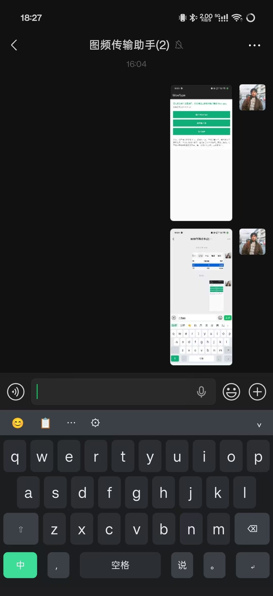
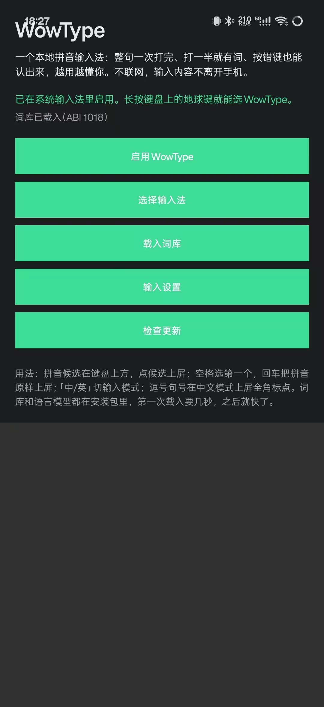
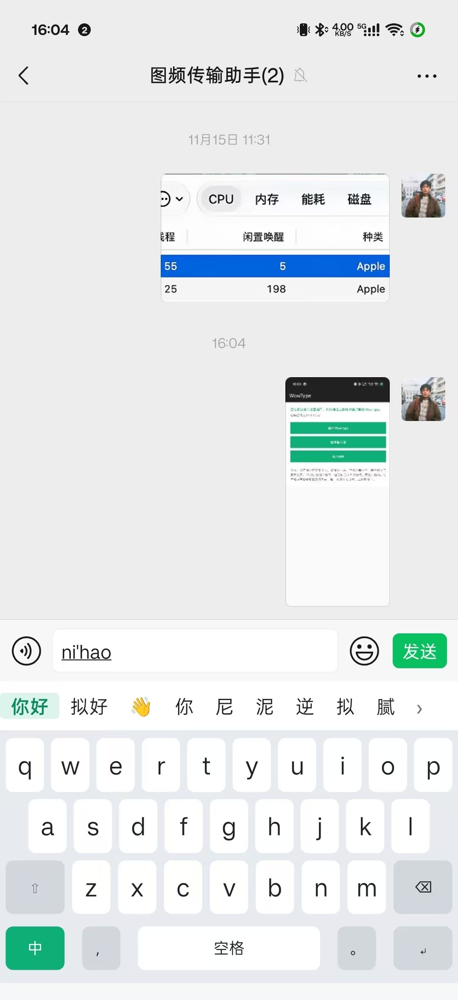
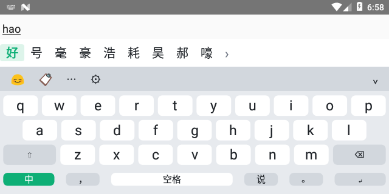
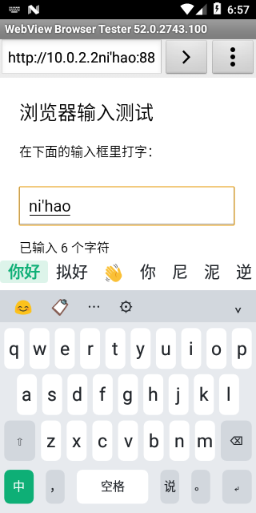
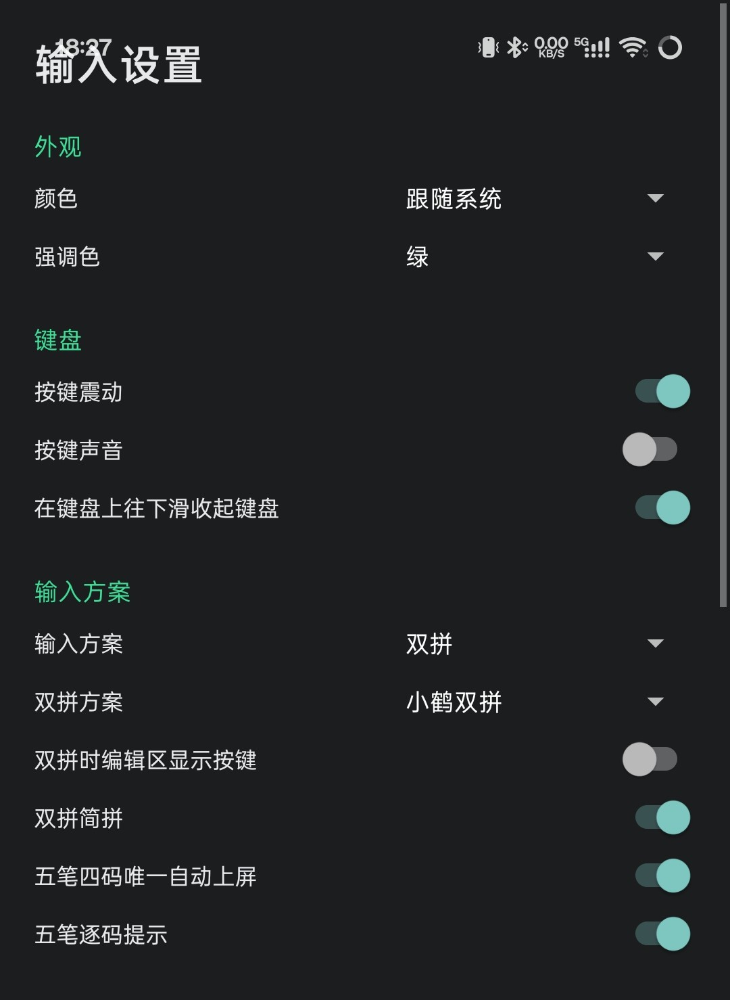
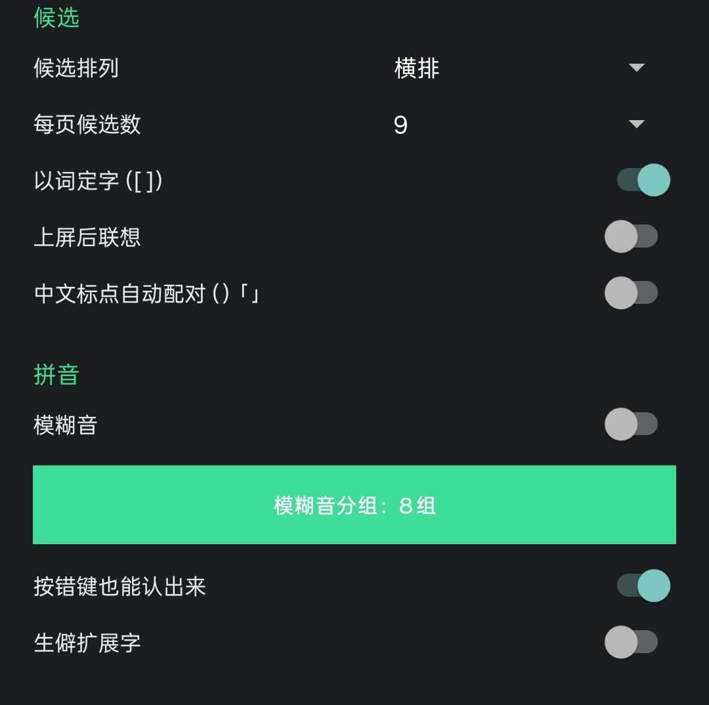
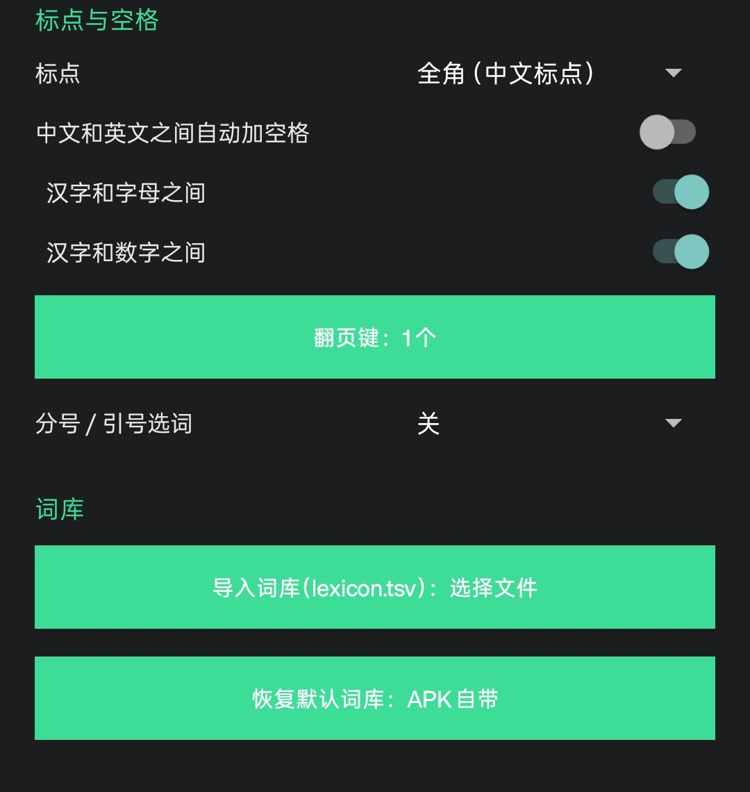
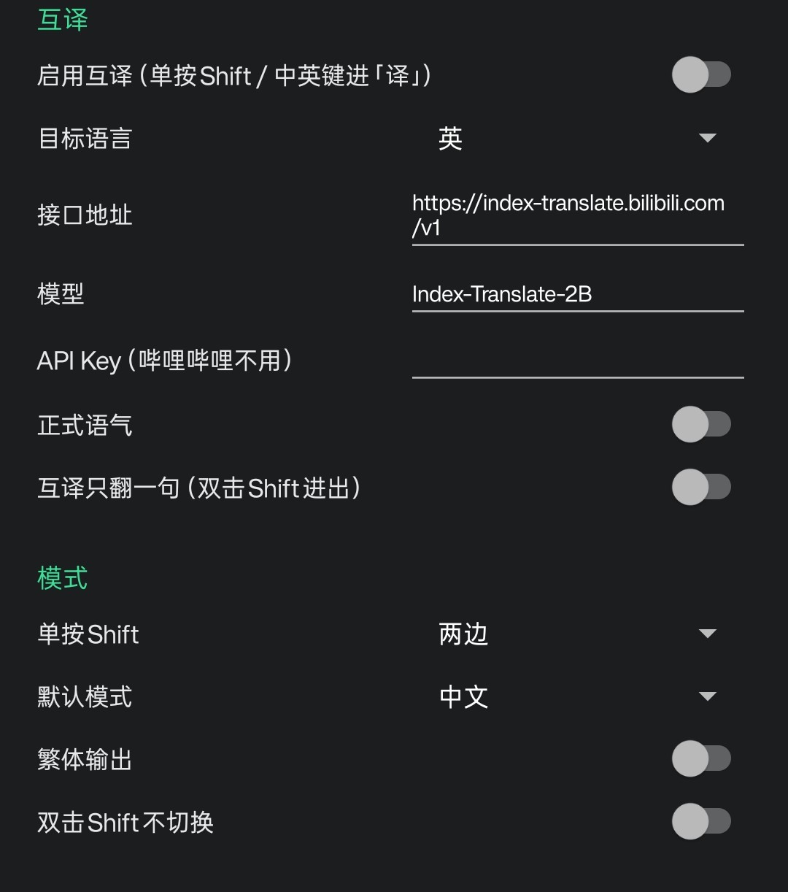
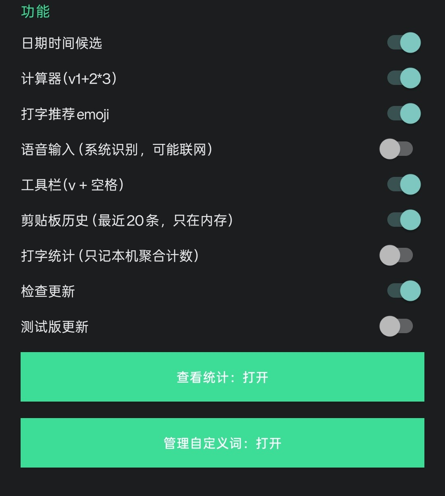

# 安卓输入法外壳

> 状态（2026-11）：第一版，**arm64 优先**。拼音、候选、整句、纠错、学习中英文都在核心里，
> 这里是一个新外壳（和 `fcitx5-addon/`、`macos/` 平级）。已在真机上跑过（截图见下），仍按测试版看待。

## 做出来的东西

- 一个 APK，自带词库（rime-ice，929k 条）、词级语言模型、英文词表；第一次打开时解到应用私有目录，
  之后直接用。不联网，输入内容不出手机。
- 软键盘：四行 QWERTY、Shift、退格、空格、回车、逗号、句号、中/英切换；在键盘上往下滑
  收起键盘。按键震动默认开、按键声音默认关，设置「键盘」里可关。
- 候选条在键盘上方，横排可滚动，点候选上屏；有上一页 / 下一页。
- 拼音行为全部来自 `core/` 的输入会话（ABI 1.10）：整句（`xiangquzijieshangban`）、半成品（`zhongg`）、
  按错键（`weixni` → 微信）、简拼混打、中英混打、标点、数字选词、学习。和 Linux / macOS 共用一套按键语义。
- 中 / 英模式跨输入框保留；英文模式下字母原样交给应用。
- 外接键盘 / Chromebook / 桌面模式：`onKeyDown` 也翻成 keysym 交给会话。
- 设置页：启用、打开系统输入法选择器、提前载入词库、显示词库状态和 ABI 版本。
- 输入设置（和桌面设置窗口的对应项）：全拼 / 双拼（七种方案、显示键位、简拼）/ 五笔 86、模糊音（16 组）、
  按错键纠错、生僻扩展字、候选横排 / 竖排、每页候选数、以词定字、联想、全角 / 半角标点、
  中英文自动空格、翻页键、分号选词、单按 Shift、默认模式、繁体输出、日期时间、计算器、emoji 推荐、
  中文标点自动配对、互译只翻一句、双击 Shift 不切换、五笔四码自动上屏/逐码提示、
  工具栏、剪贴板历史、外观（跟随系统 / 浅色 / 深色、绿蓝紫橙粉强调色）。改完立刻生效，
  存在 SharedPreferences 里。
- 键盘上沿工具条：😊 表情、📋 剪贴板、⋯ 更多（常用语/符号/表情）、⚙ 设置、⌄ 收起键盘；
  也可以只打一个 `v` 再按空格出工具栏。外接键盘 `Super + .` 开表情面板。
  剪贴板历史默认关，读系统剪贴板后最近 20 条只在内存里。
- 打字统计（默认关）：本机按天记字数、活跃时长、按键热力、候选位置；设置里「查看统计」看，能清空。
- 自定义词：设置里增删、导入导出，写和桌面同一个 `custom.tsv`，改完引擎立刻重读。
- 词库：设置里可以导入 Rime 词库转换出来的 `lexicon.tsv`（万象等）并立即切换，也能恢复 APK 自带的；
  导入的文件存在应用私有目录。没有内置的万象下载。
- 键盘无障碍：自绘键盘用 `AccessibilityNodeProvider` 把每个键暴露给 TalkBack，双击等于点一下。
- 检查更新：默认每天一次，可以关；打开「测试版更新」时预发布版本也算。只提示并打开下载页。
- 语音输入：键盘上的「说」键用系统语音识别（`SpeechRecognizer`），识别结果走 core 的
  `commit_text`；默认关，打开时要授权麦克风。系统识别可能把音频发到厂商/Google 的服务，
  和桌面版的本机 wtlocal 模型不同，设置里写明了。
- 互译：设置里填 OpenAI 格式接口（地址、模型、API Key）或直接用默认的哔哩哔哩 Index-Translate
  （不用 Key）。「中/英/译」键循环到「译」，照常打中文，停一下译文出现在编辑区，回车/上屏。
  桌面版用系统 curl，安卓用系统 HTTPS 请求；Key 存在应用私有 SharedPreferences 里。

## 真机截图

<table>
<tr>
<td align="center" width="50%"><br><sub>微信里的深色键盘和工具条</sub></td>
<td align="center" width="50%"><br><sub>启用 WowType、载入词库</sub></td>
</tr>
</table>

<p align="center"><br><sub>微信里打 ni'hao 的候选（早期版本，还没有工具条）</sub></p>

### 模拟器补测

横屏和浏览器这两项还没在真机上跑，先用模拟器补：

<table>
<tr>
<td align="center" width="50%"><br><sub>横屏 640×320：键盘 170dp，输入框和候选条都在</sub></td>
<td align="center" width="50%"><br><sub>浏览器（WebView shell）页面输入框打 ni'hao</sub></td>
</tr>
</table>

输入设置原来是 1080×6117 的滚动长截图，按小节切成 5 张（也可以看[完整长图](../docs/images/android-settings-full.jpg)）：

<table>
<tr>
<td align="center" width="33%"><br><sub>外观、键盘、输入方案</sub></td>
<td align="center" width="33%"><br><sub>候选、拼音</sub></td>
<td align="center" width="33%"><br><sub>标点与空格、词库</sub></td>
</tr>
<tr>
<td align="center" width="33%"><br><sub>互译、模式</sub></td>
<td align="center" width="33%"><br><sub>功能</sub></td>
<td align="center" width="33%"></td>
</tr>
</table>

## 这一版没有的

万象词库的内下载：可以在设置里「导入词库」选转换好的 `lexicon.tsv`（万象等）立即切换，但不会在
App 里直接下载大词库包。以后加新功能时仍按 `docs/PORTING.md` 的边界接，不要在 Java 里重写输入行为。

## 安装

```bash
adb install dist/android/WowType-<版本>-android-arm64-v8a.apk
```

装完点开 WowType → 「启用 WowType」→ 在系统设置里打开它 → 回到任意输入框，
长按键盘上的地球键选 WowType。第一次载入词库要几秒，状态在设置页里能看到。

不通过 Play 分发，用自签名（`android/build.sh` 生成 `dist/android/wowtype-android.keystore`，
口令 `wowtype`）。装别的机器上要自己保管好密钥库，换签名后不能覆盖安装。

## 构建

要 JDK 17+、Android SDK（`platforms;android-35`、`build-tools;35.0.0`）、
NDK（`ndk;27.2.12479018`）和 Rust 的 `aarch64-linux-android` 目标：

```bash
rustup target add aarch64-linux-android
export ANDROID_HOME=$HOME/Android/Sdk
export ANDROID_NDK_HOME=$ANDROID_HOME/ndk/27.2.12479018
scripts/make-data.sh "" dist/data          # 词库 + words.lm（约 65 MB，几秒到一分钟）
android/build.sh dist/data dist/android    # 默认只打 arm64-v8a
```

要别的架构再打（模拟器用 x86_64）：

```bash
WOWTYPE_ANDROID_ABIS="arm64-v8a x86_64" android/build.sh dist/data dist/android
```

`armeabi-v7a`（32 位 ARM）脚本也支持，但要先 `rustup target add armv7-linux-androideabi`；
这条路径还没在真机上验过。

产物是每个架构一个 APK（不是 universal），文件名里带架构。发版只发 arm64 那一个。
签名可以用自己的密钥库：`WOWTYPE_ANDROID_KEYSTORE`、`WOWTYPE_ANDROID_KEYSTORE_PASS`、
`WOWTYPE_ANDROID_KEY_PASS`、`WOWTYPE_ANDROID_KEY_ALIAS`。CI 里配上
`WOWTYPE_ANDROID_KEYSTORE_BASE64`（密钥库文件的 base64）和对应的口令，每次发版都用同一把密钥，
用户才能直接覆盖升级；没配时每次构建会生成新密钥，旧的装不上去。

没有用 Gradle：和 `macos/build.sh` 用 `swiftc` 直接编一样，`android/build.sh` 直接用 SDK 的
`aapt2` / `javac` / `d8` / `zipalign` / `apksigner` 拼出 APK。少一层构建工具，CI 和本机一样。

## 测试

```bash
android/test.sh dist/data
```

不需要设备：把 `wowtype_jni.c` 和核心静态库链成主机 `.so`，用主机 JVM 跑
`android/hosttest/NativeTest.java`。它验的是 APK 里真正跑的那一层——UTF-8 → jstring（emoji 这种
四字节序列）、frame 打包、拼音 `ni'hao` → 你好、空格选词、回车原样上屏、退格、`weixni` → 微信、
中英切换。UI（候选条点按、软键盘坐标）只能在模拟器 / 真机上验，见下。

模拟器上手动验一遍（`android/build.sh` 打 x86_64，`adb install` 之后）：

1. 设置 → 语言和输入法 → 启用 WowType，选作当前输入法；
2. 在搜索框里点 `n i h a o`，候选条第一个是「你好」，点它上屏；
3. 打 `weixni`，第一个候选是「微信」；空格也选第一个；
4. 点「中/英」，字母直接进输入框；再点一次回到中文；
5. 回车：拼音原样上屏；退格：先删拼音，再删已上屏的字。

## 目录

```
android/
  build.sh              打 APK（aapt2 + javac + d8 + apksigner）
  test.sh               主机 JVM 上跑 JNI + 会话
  hosttest/NativeTest.java
  app/
    AndroidManifest.xml
    res/                图标、字符串、输入法清单
    jni/wowtype_jni.c   JNI 桥（Object[] 打包 frame，UTF-8 → UTF-16）
    java/io/github/gloridust/wowtype/
      Native.java       native 方法
      Frame.java        会话一次调用的结果
      Session.java      wowtype_session_* 的 Java 包装
      EngineHost.java   一个进程一份引擎，后台载入、存学习数据
      DataFiles.java    APK 里的词库解到私有目录
      WowTypeImeService.java  InputMethodService：按键 → 会话 → InputConnection
      KeyboardView.java 自绘软键盘
      CandidateBar.java 候选条
      SetupActivity.java 启用页
```

## 数据与许可证

词库来自 [rime-ice](https://github.com/iDvel/rime-ice)（GPL-3.0），词频另用了 Tatoeba 中文句子
（CC BY 2.0 FR）的统计；`words.lm` 是 CC BY-SA 4.0。许可证和来源随 APK 解到私有目录（`LICENSE`、
`SOURCE.txt`），和 Linux / macOS 安装包里的是同一份。微信输入法的语音模型、NNLM 等不分发。
